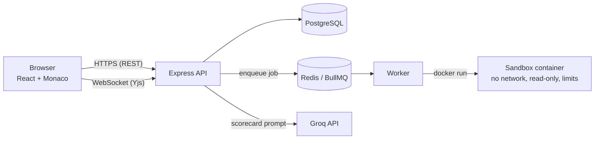

# CodeRoom

A live technical interview platform: interviewers and candidates share a real-time code editor, run code in
isolated Docker sandboxes, get automatic grading against hidden test cases, and the interviewer receives
an AI-assisted scorecard.


**Live demo:** <<https://your-link, or delete this line>> · **Video (2 min):** <<YouTube or Drive link>>

## Why I built it

Platforms like CoderPad and HackerRank have to run code from strangers safely, and keep two people's editors
in sync. I wanted to solve both problems end to end, and then attack my own solution to see where it broke.

## Features

- **Real-time collaborative editor:** Monaco + Yjs (CRDT), named cursors, shared language and stdin
- **Sandboxed execution** for Python, C++ and Java, with separate compile and run time limits
- **Auto-grading** with visible and hidden test cases, run in parallel across a worker pool
- **AI scorecard** (Groq) with validated JSON output, retry on bad output, and prompt-injection defenses
- **Interviewer dashboard:** past interviews, every attempt, per-test results, final code, scorecard
- **Role-based access** (interviewer / candidate), per-room authorization on REST and WebSocket

## Screenshots

| Live interview | Grading | Scorecard |
|---|---|---|
|  |  |  |

## Architecture



**Request flow for "Submit":** the API checks room membership and rate limits, enqueues one job per test case,
waits for the results, compares outputs on the server (so hidden test data never leaves it), stores a sanitized
result, and returns it. The browser publishes the result into the shared Yjs document so both people see it.

## Tech stack

| Layer | Choice |
|---|---|
| Frontend | React, TypeScript, Vite, Tailwind, Monaco Editor |
| Real-time | Yjs (CRDT), y-websocket, authenticated WebSocket upgrade |
| Backend | Node.js, Express 5, Zod, Prisma |
| Data | PostgreSQL, Redis |
| Queue and workers | BullMQ, Docker |
| AI | Groq (OpenAI-compatible API), model `<<your GROQ_MODEL>>` |
| Auth | JWT, bcrypt, role checks, invite code for interviewer accounts |

## Security model

### What untrusted code can try, and what stops it

| Attack | Defence |
|---|---|
| Infinite loop | Host-side timer plus `docker kill` (the timeout is enforced outside the container) |
| Fork bomb / thread bomb | `--pids-limit` |
| Memory exhaustion | `--memory` with swap disabled; JVM `-Xmx` below the container limit |
| Network access, reaching the database | `--network none` |
| Writing files, filling the disk | `--read-only`, small `tmpfs`, read-only source mount |
| Privilege escalation | `--cap-drop ALL`, `no-new-privileges`, non-root user, Docker's default seccomp profile |
| Output flooding | 64 KB output cap, then kill |
| Compiler abuse (`#include "/dev/zero"`) | Separate compile timer and memory limit |
| Faking a compile error | Per-job random markers |

**Evidence:** an automated suite of <<N>> attacks across 3 languages: **<<X/N>> contained**, with no leftover
containers. See [`worker/tests/RESULTS.md`](worker/tests/RESULTS.md).

### Application security

An automated suite of <<M>> checks covers authentication, roles, ownership (IDOR), input validation, hidden
test-data leaks, security headers and WebSocket authorization: **<<Y/M>> passing**.
See [`server/tests/SECURITY.md`](server/tests/SECURITY.md).

- Hidden test cases are filtered **on the server**; their inputs and expected outputs never reach a browser,
  including through `GET /jobs/:id` and the stored results.
- Every room route checks **membership**, not only login. Other people's interviews return `404`, not `403`.
- Interviewer accounts require an invite code. Login runs a constant-work password check.
- After an interview ends, the server **refuses new WebSocket connections** and saves its own copy of the code.
- Startup refuses to run with a weak `JWT_SECRET`. Rate limits cover login, run, submit and scorecards.

### AI scorecard design

- **Correctness is computed from test results**, not by the model, so it cannot be talked into a different number.
- The candidate's code is treated as untrusted data in the prompt (a prompt-injection test is in the demo).
- The model output is validated with Zod and retried once with the error message on failure.
- The candidate's name is not sent to the model. Communication is not scored, because it is not observed.
- The UI states that scores are AI estimates that assist the interviewer and are not a hiring decision.

### Known limitations (honest list)

- Docker containers share the host kernel. A kernel exploit could escape them. Systems running hostile code at
  scale use gVisor or Firecracker microVMs. This is the top item under future work.
- The JWT is stored in `localStorage` (an XSS bug would expose it). The WebSocket token travels in the URL query
  string. Production fixes: httpOnly cookies and short-lived single-use WebSocket tickets.
- Yjs documents live in server memory and are not persisted while a room is open. Abandoned rooms that never
  end stay in memory until the server restarts.
- C++ and Java recompile for every test case. A compile-once mode would cut grading time.
- Code is sent to a third-party LLM provider for scoring, which needs consent in a real product.

## Performance

Burst benchmark: all jobs submitted at once, one warm-up run excluded. Machine: <<CPU, RAM, Windows + Docker
Desktop>>. Measured with [`worker/tests/load.ts`](worker/tests/load.ts).

<<paste the table from worker/tests/BENCHMARK.md>>

Most latency for small programs is container startup. A warm pool of pre-started containers is the next
optimization.

## Run it locally

Requirements: Node 20+, Docker Desktop (or Docker Engine).

```bash
git clone <<repo url>>
cd coderoom
docker compose up -d                 # PostgreSQL on 5433, Redis on 6379

# sandbox images (first run only)
docker pull python:3.12-alpine
docker pull eclipse-temurin:21-jdk-alpine
docker build -t coderoom-cpp -f worker/docker/cpp.Dockerfile worker/docker

# server
cd server
cp .env.example .env                 # then edit: JWT_SECRET, invite code, optional GROQ_API_KEY
npm install
npx prisma migrate deploy
npm run seed
npm run dev

# worker (new terminal)
cd worker && npm install && npm run dev

# client (new terminal)
cd client && npm install && npm run dev      # http://localhost:5173
```

Generate a secret: `node -e "console.log(require('crypto').randomBytes(48).toString('hex'))"`

Create an interviewer account using the invite code from your `.env`, and a candidate account in a private window.

### Tests

```bash
cd worker && npx tsx tests/abuse.ts     # sandbox attacks (needs Docker)
cd server && npm run test:security      # access rules (server must be running)
cd worker && npx tsx tests/load.ts python 30 2
```

## Project structure

```
client/   React app (pages, components, Yjs hook)
server/   Express API, Yjs WebSocket server, grading, scorecard service, Prisma schema
worker/   BullMQ worker and the Docker sandbox runner, plus abuse and load tests
```

## Future work

gVisor or Firecracker isolation · warm container pool · compile-once grading · more languages ·
session replay · video calls · httpOnly cookies and WebSocket tickets · persisted Yjs documents · a real
organization and invitation model.

## What I learned

<<Write 3 or 4 honest sentences: for example, debugging a port conflict between a Windows Postgres service and a
Docker container, why a timeout must be enforced outside the thing being timed, what prompt injection taught
you about not trusting a model with a number that matters.>>